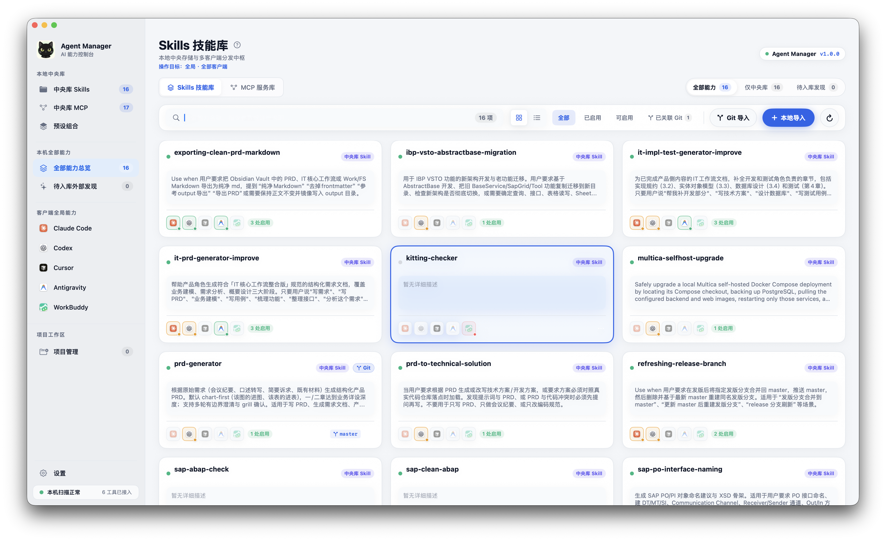

<p align="center">
  
</p>

<h1 align="center">Looma</h1>

<p align="center">
  <strong>现代化、跨平台的本机 AI 客户端 Skill 与 MCP 配置统一管理中心</strong>
</p>

<p align="center">
  <a href="https://github.com/Whisky-s/Looma/releases/latest">
    
  </a>
  
  
  
  
</p>

<p align="center">
  
</p>

---

## 📖 简介

**Looma** 是一款专注于本地 AI 编程助手配置管理的桌面应用。通过建立集中的“中央能力库”，帮助开发者轻松管理、同步和复用多个 AI 客户端的 **Skill 技能包** 与 **MCP (Model Context Protocol)** 配置文件。

已全面支持主流 AI 客户端：
- **Claude Code** (CLI)
- **Codex** (CLI / VS Code)
- **Cursor**
- **Antigravity** (Google)
- **Qoder**
- **WorkBuddy**

---

## ✨ 核心特性

* 🎯 **全客户端自动发现**：自动扫描本机支持的 AI 客户端，检测全局用户配置与指定项目级工作区的配置目录。
* 📦 **Skill 中央库与一键分发**：
  * 支持从本地目录或 Git 远程仓库一键导入技能包，保留版本与更新历史。
  * 分发时支持 **符号链接 / NTFS Junction 目录联接** 或 **独立拷贝模式**，支持随时一键撤销部署。
* 🔌 **MCP Server 可视化配置中心**：
  * 支持 JSON / TOML 跨格式解析与导入，提供可视化的参数、命令与环境变量编辑。
  * 智能识别客户端内置系统服务，提供同名覆盖拦截与命名冲突预警。
* 🎛️ **预设组合（Presets）**：
  * 将中央库的 Skill 与 MCP 组合为不同场景的预设方案（如：前端开发、数据分析、运维巡检）。
  * 一键预览配置替换计划，支持多客户端同时应用或安全撤销。
* ⏪ **原子级快照与安全回滚**：
  * 所有配置文件写入前自动生成本地快照备份。
  * 完整记录本机操作流水，支持一键撤销并按时间逆序安全回滚历史变更。
* 🔒 **100% 隐私安全**：
  * 所有配置、本地模型参数与 MCP 凭据**仅保存在本机**，绝不进行任何云端数据上传。

---

## 🏗️ 双架构体系设计 (Dual Architecture)

本项目采用针对操作系统深度优化的双架构模式：

| 平台 | 技术栈 | 核心优势 | 对应源码目录 |
| :--- | :--- | :--- | :--- |
| **macOS** | **Swift + SwiftUI + AppKit** | 纯原生极致性能、macOS 毛玻璃质感、系统状态栏菜单常驻、Apple Silicon 原生优化 | 根目录 (`Sources/`, `Package.swift`) |
| **Windows** | **Tauri 2.0 + Rust + React 19** | 内存占用低（~20MB）、原生 NTFS Junction 目录联接适配、注册表智能扫描、Tailwind 视觉复刻 | [`windows/`](windows/) 目录 |

---

## 📥 下载安装

请前往 [GitHub Releases](https://github.com/Whisky-s/Looma/releases/latest) 下载对应平台的安装包：

* **macOS 用户**：下载 `Looma-macOS-Universal-*.dmg`（通用架构，原生支持 Apple Silicon M系列 与 Intel 处理器）。
* **Windows 用户**：下载 `Looma_*_x64-setup.exe`（安装向导）或 `.msi` 独立安装包。

---

## 🛠️ 本地开发与构建

### 1. macOS 原生版本构建

**前置要求**：macOS 14+ 及 Xcode 15+。

```bash
# 运行自动化回归与核心逻辑测试
zsh scripts/smoke.sh

# 编译并在本地生成未签名的应用包
zsh scripts/build-app.sh
open "dist/Looma.app"

# 打包双架构 Universal DMG 安装镜像
zsh scripts/package-app.sh
```

### 2. Windows 版本 (Tauri) 开发

**前置要求**：Node.js 20+、Rust 1.80+。

```bash
cd windows

# 安装前端依赖
npm install

# 启动本地热重载调试（可在 Mac/Windows 上直接调起原生调试窗口）
npm run tauri dev

# 仅调试前端 Web 界面
npm run dev

# 生产环境编译（或通过 GitHub Actions 自动打包）
npm run tauri build
```

---

## 💾 本地数据目录说明

应用产生的中央库、预设组合、项目列表与备份快照存放在本机用户目录中：
* **macOS**：`~/Library/Application Support/AgentManager/`
* **Windows**：`%APPDATA%\AgentManager\`

> [!NOTE]
> 包含 API Key 或敏感环境变量的 MCP 模板和快照文件均设置了仅限当前操作系统用户读写的权限，请勿将上述本地数据目录直接同步到公开仓库。

---

## 📄 开源许可证

本项目基于 [MIT License](LICENSE) 开源。
